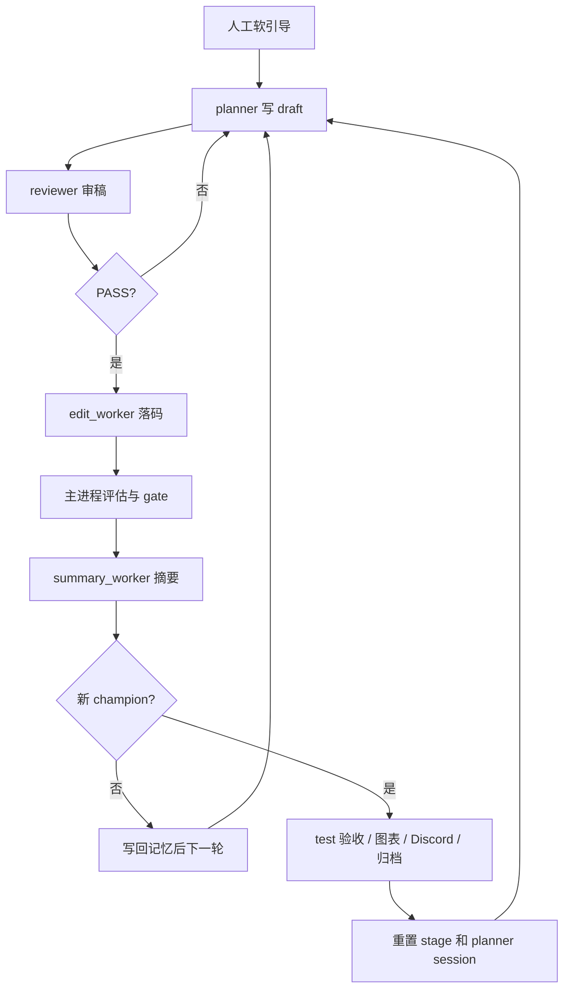

# Quant AI Research

`OKX BTC-USDT-SWAP` 激进趋势策略研究仓库。这里的 `SWAP` 指 OKX 的 `USDT` 本位永续合约。

> 新研究框架的基线、有限批量搜索、方向轮换和 Plus 假设入口已接通；以下旧版 v2 多 Agent 流程仅作历史参考，默认不启动。当前新入口是 `scripts/research_control.py`。研究数据尚未重新下载，所以新流程仍未经过真实行情检验。

## 新研究管理方式

新框架先保留旧策略和回测器作为待复现基线。参数搜索在本地运行；AI 只在取得一批实验结果后提出下一轮假设。每次 AI 调用都使用新的只读 Codex 会话，并且必须确认机器当前使用 ChatGPT 登录。不会调用 OpenAI API Key 或 DeepSeek。

固定数据文件到位后，使用 `baseline` 命令传入 15 分钟行情、1 分钟执行行情和资金费率文件，就能按配置中的固定训练与验证窗口复现旧策略。该命令要求手续费、滑点、资金费率和 1 分钟执行数据齐全，自动记录数据及代码指纹；缺文件或资金费率覆盖不足会停止，不生成成绩。具体参数可查看 `.venv/bin/python scripts/research_control.py baseline --help`。

基线建好后，`search` 对指定方向执行一批参数搜索；`auto` 按尝试次数轮换四个方向，单次最多运行配置允许的批次数。每批只用训练期筛选参数，仅训练第一名进入四段按时间排列的验证期；冻结测试期不参与搜索。参数范围、每批数量及运行上限都在 [config/research_control.toml](config/research_control.toml)，初始取值只是待检验范围，不是推荐交易参数。参数空间用尽或方向暂停时停止，不会无限运行，也不会自动调用 AI。

实验账本记录代码版本、数据版本、训练和验证成绩。小幅改善、单一区间改善或明显增加回撤都不能刷新研究基准；连续无实质进展的方向会暂停。旧策略读取内部固定参数，搜索器会在每次回测时同步设置并在结束后恢复，避免“记录变了而信号没变”。

查看当前状态：

```bash
.venv/bin/python scripts/research_control.py status
```

数据与基线就绪后的本地搜索命令（用实际 CSV 路径替换示例路径）：

```bash
.venv/bin/python scripts/research_control.py auto --intraday data/okx_15m.csv --execution data/okx_1m.csv --funding data/okx_funding.csv
```

单方向搜索使用 `search --direction entry`，并传入相同的三个数据路径。每批完整训练排序写入 `research/batches/`，获选参数及验证成绩写入 `research/experiments.jsonl`。该目录不存原始行情。

有真实回测结果后，可以先生成不消耗 AI 用量的研究摘要；明确需要新假设时再调用 Plus 账户：

```bash
.venv/bin/python scripts/research_control.py propose
.venv/bin/python scripts/research_control.py propose --use-ai
```

`--use-ai` 每轮最多调用一次、每天最多两次；次数是本地保护上限，不代表 Plus 额度可以按次数精确换算。AI 建议只保存在 `research/proposals.jsonl`，不会自动修改策略。实验账本格式和保存方式见 [research/README.md](research/README.md)，完整边界见 [docs/research_control_design.md](docs/research_control_design.md)。

当前电脑已确认 Codex CLI 使用 ChatGPT 登录。新数据和基线尚未建立，`search`、`auto` 和 `propose` 都会先停止并说明原因。现有季度验证并不等于完整滚动训练，也不能替代最终样本外和模拟盘验证。旧版循环若确需运行，必须显式设置 `MACD_V2_ALLOW_LEGACY=1`，且它不受这套新管理器的调用限额保护。

这个仓库维护的是一条连续研究主线：同一套策略源码、同一套回测器、同一套研究器，以及一套后续可接 `OKX` 自动交易的实盘外壳。当前这个 clone 还额外挂了一条 `planner-only` 的 DeepSeek 对照实验线，用来验证研究方向生成环节是否更适合切模型。

## 当前范围

- 策略源码：[src/strategy_macd_aggressive.py](src/strategy_macd_aggressive.py)
- 回测器：[src/backtest_macd_aggressive.py](src/backtest_macd_aggressive.py)
- 研究器：[scripts/research_macd_aggressive_v2.py](scripts/research_macd_aggressive_v2.py)
- 管理脚本：[scripts/manage_research_macd_aggressive_v2.sh](scripts/manage_research_macd_aggressive_v2.sh)
- stage 重开脚本：[scripts/reset_research_macd_aggressive_v2_stage.sh](scripts/reset_research_macd_aggressive_v2_stage.sh)
- 数据下载脚本：[scripts/download_aggressive_data.py](scripts/download_aggressive_data.py)
- 实盘外壳说明：[real-money-test/README.md](real-money-test/README.md)
- DeepSeek planner 实验说明：[docs/deepseek_planner_experiment.md](docs/deepseek_planner_experiment.md)

每次出现新的 `champion` 时，研究器现在还会额外归档一份独立快照到：

- `backups/champion_history/<timestamp>_i<iteration>_<candidate_id>_<codehash>/`

目录内默认包含：

- `strategy_macd_aggressive.py`
- `metadata.json`
- 若当轮图表生成成功，还会带上 `selection.png` 与 `validation.png`

## 数据与评分

- 数据源：`OKX`
- 事实层：`15m`
- `1h / 4h` 由 `15m` 聚合得到，只做趋势和环境确认
- 回测执行价优先使用 `1m`
- 当前评分口径：`robust_block_v27_exposure_activity`

时间窗口：

- `train`：`2023-07-01` 到 `2024-12-31`
- `val`：`2025-01-01` 到 `2025-12-31`
- `test`：`2026-01-01` 到 `2026-04-30`

晋升规则：

- 候选必须先过 `gate`
- 已有 champion 时，候选还必须 `promotion_score` 严格高于当前 active reference 才能刷新；当前取消的是额外晋级边际，不是“过 gate 就替换”
- v28 主分使用有效活跃度调整后的稳健时间块收益：train/val 各自用 `28` 天收益块的 `mean/median/P25` 聚合，`min` 只做诊断；低月频或低持仓覆盖先触发硬 gate，过 gate 后正收益仍按活跃度打倍率，负收益不打折
- `main_score = robust_time_score - benchmark_hurdle_score`，其中正向 buy&hold 稳健分按 `0.25` 形成轻量基准扣分
- `promotion_score = main_score - drawdown_penalty_score - robustness_penalty_score`
- `capture_score` / `capture_core` 只作为趋势诊断，不进入主评分，也不再给收益做倍率；capture 仍使用固定 clean trend segments，并保留“段等权均分 50% + 原权重均分 50%”的混合口径
- 默认研究画像是 `long / flat`；`short` 只作为高置信辅助。short 占比和多空 capture 只做诊断，不进入评分或 gate，研究器可以主动收窄无效 short。
- Fear & Greed 情绪数据现在只作为可选 `market_state` 信息源暴露给策略，字段包括 `sentiment`、`fear_greed_value`、`fear_greed_ema7`、`fear_greed_delta1/3/7`；它不进入评分、gate 或 planner 强制目标
- Sharpe 不进入主评分，只保留为人工筛选和通知展示指标
- 有效活跃度按“非加仓开仓月频 × 持仓覆盖率”计算：train/val 必须分别达到至少 `5` 笔/月和 `5%` 持仓覆盖，否则 gate 失败；目标约 `10-15` 笔/月，持仓覆盖率约 `16%` 起给满覆盖倍率；单纯刷开仓数但大部分时间空仓会显著折扣正收益
- 回测执行层允许总仓位上限内多空并行；`max_concurrent_positions` 统计独立 position，加仓只改变已有 position 的规模，不占用这个数量；混合持仓时，信号层按方向扫描持仓，不再只看第一个 position
- Regime scorecard 只做解释工具，不进入评分或 gate；它复用已有 ADX/CHOP/ATR、flow、成交量代理、Fear & Greed 和价格自身波动，帮助判断什么时候适合动量、什么时候应该缩手
- 鲁棒性软惩罚不额外回测；它复用已有 train/val 稳健收益块和 `train/val` Ulcer，检查两侧分布是否严重不一致
- `train` walk-forward 均值/中位数现在按 robust block 分计算，只做诊断；严重过拟合集中度继续用于 gate
- 明显差候选的提前淘汰会复用已完成的 walk-forward 窗口结果，不再额外重跑累计 train 区间
- `test` 对新 champion 同步运行；对已完成完整评估但未保留的候选会后台异步补跑关键指标，只做观察记录，不参与晋升，也不进入 prompt
- 复杂度默认只做诊断，不拦普通候选；若普通轮出现明显复杂度增长但未晋级，或同一 slot / cluster 连续失败 3 次，系统会排队下一轮结构自检修复。自检轮通过现有基础安全门后跳过 `promotion_score` 比较并替换 active reference
- `config/research_v2_champion_review.md` 是绑定当前 champion hash 的人工观察卡，只给 planner 做软引导；新 champion 后自动忽略，直到人工更新 hash。

## 研究器工作流

研究器当前按 [docs/agent_subagent_workflow.md](docs/agent_subagent_workflow.md) 的 SOP 运行。核心链路是：

```text
人工软引导 -> planner draft -> reviewer 审稿 -> edit_worker 落码 -> 主进程评估 -> summary_worker 摘要 -> champion 或下一轮
```

关键点：

- 普通研究轮的 `planner` 是唯一持久 session，只负责想方向和写 `draft brief`；结构自检修复轮使用独立短 session。
- `reviewer` 每轮 fresh，只判断 draft 是否值得落码，结论只有 `PASS / REVISE`。
- `edit_worker` 只改 [src/strategy_macd_aggressive.py](src/strategy_macd_aggressive.py)。
- 主进程负责 `diff / smoke / behavioral_noop / exit_range_scan / full eval / gate / 归档 / 播报`；`exit_range_scan` 只做单参数 3 点轻量预筛。
- 没有刷新 `champion` 时，结果写回 `journal / wiki / reviewer_summary_card / direction_board`；若该轮已完成 full eval，还会后台异步补跑 `test` 关键指标留档，然后继续同一 stage。
- 如果普通轮触发结构自检，下一轮只做删减、合并、参数化泛化或移除无效分支；自检轮仍必须过源码校验、smoke、完整评估和 gate。
- 同一 stage 内，即使出现 reviewer 打回、`behavioral_noop`、同轮重生或方向切换，`planner` 也不自动重置 session；只有手工重开 stage 或刷新 `champion` 才重置。
- 刷新 `champion` 时，会同步跑 `test`、归档快照，然后重置 stage 和 planner session。
- `config/research_v2_champion_review.md` 是绑定当前 champion hash 的短人工观察卡；新 champion 后自动失效。

当前为了控制主文件体积，研究器相关代码已经拆到这些辅助模块：

- `src/research_v2/reference_state.py`：active reference 持久化与恢复
- `src/research_v2/champion_artifacts.py`：champion 快照与图表说明
- `src/research_v2/backtest_window_runtime.py`：回测窗口切片与运行态准备
- `src/research_v2/evaluation_summary.py`：评分汇总文本与指标组装
- `src/research_v2/journal_prompt_builder.py`：journal prompt 摘要组装



## DeepSeek Planner 实验现状

当前仓库采用的是 `planner-only` 的 DeepSeek 实验接法。

### 当前接法

- `planner`：走 DeepSeek 官方兼容 API
- `planner` 当前模型：`deepseek-v4-pro`
- `thinking`：开启
- `reasoning_effort`：`max`
- `reviewer / edit_worker / repair_worker / summary_worker`：继续走原来的 Codex / GPT 链路
- 切换入口：`config/secrets.env` 中的 `MACD_V2_PLANNER_PROVIDER=deepseek`
- 生效范围：只有 `session_kind=planner` 时才会走 DeepSeek
- 规则继承方式：实验接法会把工作区 `AGENTS.md` 的全文显式注入 `planner` 的 system prompt，保证原有 `apply on planner` 规则继续生效
- DeepSeek planner 的多轮上下文保存在 `state/research_macd_aggressive_v2_agent_workspace/.deepseek_planner_session_*.json`
- DeepSeek planner 的 trace 额外保存在 `state/research_macd_aggressive_v2_agent_workspace/.deepseek_planner_trace_*.jsonl`
- 同一 stage 内不会因为 `behavioral_noop`、reviewer 打回或方向切换而重置 planner session
- 本地 session 默认只保留最近 `12` 条非 system 历史消息；`reasoning_content` 只写 trace，不再回灌到 session history
- 模型调用 telemetry 同时记录原始 prompt 大小与真实发送上下文大小，便于核对内联 `AGENTS.md` 和历史消息带来的成本

### 当前实验结论

截至 `2026-04-26` 这轮运行观察，当前观察是：

- `GPT` 更适合固定框架、规则严密、执行链稳定的角色，例如 `reviewer / edit_worker / repair_worker / summary_worker`
- `DeepSeek` 在发散找方向、提出新假设、快速换研究层级这类 `planner` 任务里，当前表现更好

这个结论只针对当前仓库、当前评分口径 `robust_block_v27_exposure_activity` 和当前这组实验流程成立，不把它外推成所有任务的一般结论。

### 为什么保留混合架构

当前更合适的不是“全链路都换 DeepSeek”，而是：

- 让 `DeepSeek V4 Pro` 负责 `planner`
- 让原来的 Codex / GPT 链继续负责审稿、落码、修错和结果收口

原因是当前实验里，DeepSeek 更容易更快换出新方向，但 GPT 在代码层对齐、规则约束和执行链稳定性上仍然更稳。

## 手工瘦身 SOP

普通轮不会因为复杂度诊断直接被系统拒收；系统只在明显结构膨胀或同一 slot / cluster 连续失败后排队一次结构自检修复。人工仍可主动瘦身，推荐 SOP：

1. 停掉研究器
2. 手工瘦身当前策略，或手工替换 active reference
3. 若替换旧 source，先迁移到当前固定因子槽结构
4. 执行 `.venv/bin/python scripts/research_macd_aggressive_v2.py --reset-champion --no-optimize`
5. 执行 [scripts/reset_research_macd_aggressive_v2_stage.sh](scripts/reset_research_macd_aggressive_v2_stage.sh)
6. 重新启动研究器，进入新 stage

这个脚本会保留 `memory/raw/*`，但清空 front memory、session、workspace 和当前 stage journal。

补充两条边界：

- 研究器是由 `scripts/run_research_macd_aggressive_v2.sh` 的 supervisor 拉起；手工停机要走 `bash scripts/manage_research_macd_aggressive_v2.sh stop`，不要只杀 python 子进程，否则会被自动拉起。
- 当前策略是固定框架 + 固定因子槽结构；研究器只能改 `PARAMS` 既有 key、开放 `EXIT_PARAMS`、`FACTOR_SLOT_PARAMS` 和固定 `_slot_*()` 函数体，不能改 `_strategy_core()` 或新增 slot/helper。
- 研究器启动时会先从 `backups/strategy_macd_aggressive_v2_best.py` 载入 active reference 并回写到 `src/strategy_macd_aggressive.py`；手工瘦身当前基底后，要用 `--reset-champion --no-optimize` 同步 `src` 与 `best/champion` 快照。

## 常用命令

首次建立或恢复项目环境：

```bash
~/.local/bin/uv sync --locked
```

运行全部测试：

```bash
MPLCONFIGDIR=/tmp/quant-ai-matplotlib-cache .venv/bin/python -m unittest discover -s tests -p 'test_*.py'
```

测试通过后保存全部代码并上传到 GitHub：

```bash
bash scripts/save_to_github.sh "说明这次修改了什么"
```

保存脚本会先运行测试、拦截常见敏感文件、创建本地提交，再推送并核对远程提交。即使网络推送失败，本地提交仍会保留，脚本会明确提示尚未完成远程备份。

下载或重建本地 OKX 数据：

```bash
.venv/bin/python scripts/download_aggressive_data.py
```

启动研究器：

```bash
bash scripts/manage_research_macd_aggressive_v2.sh start
```

查看状态：

```bash
bash scripts/manage_research_macd_aggressive_v2.sh status
```

停止研究器：

```bash
bash scripts/manage_research_macd_aggressive_v2.sh stop
```

重开一个新 stage：

```bash
bash scripts/reset_research_macd_aggressive_v2_stage.sh
```

单轮运行一次研究器：

```bash
.venv/bin/python scripts/research_macd_aggressive_v2.py --once
```

## 文档导航

- [STRATEGY.md](STRATEGY.md)
  用非工程语言解释当前策略在看什么、怎么开仓、怎么退出。
- [docs/macd_aggressive_current_state.md](docs/macd_aggressive_current_state.md)
  解释当前评分、gate、session、memory、Discord 播报和运行目录。
- [docs/agent_subagent_workflow.md](docs/agent_subagent_workflow.md)
  专门解释 `planner / reviewer / edit_worker / repair_worker / summary_worker / 主进程` 之间怎么配合。
- [docs/deepseek_planner_experiment.md](docs/deepseek_planner_experiment.md)
  专门解释当前 `planner-only` DeepSeek 实验是怎么接的、当前观察是什么。
- [real-money-test/README.md](real-money-test/README.md)
  解释 `freqtrade` dry-run / live 外壳如何接这套策略。

## 目录速览

```text
config/              研究器配置、凭证样板、人工方向卡
data/                OKX 价格、funding、指数数据
docs/                当前状态文档
logs/                研究器日志与模型调用日志
real-money-test/     freqtrade dry-run / live 外壳
scripts/             下载、研究、管理、stage reset 脚本
src/                 策略、回测器、研究器依赖模块
state/               active reference 状态、journal、memory、heartbeat、session
tests/               研究器相关测试
```
